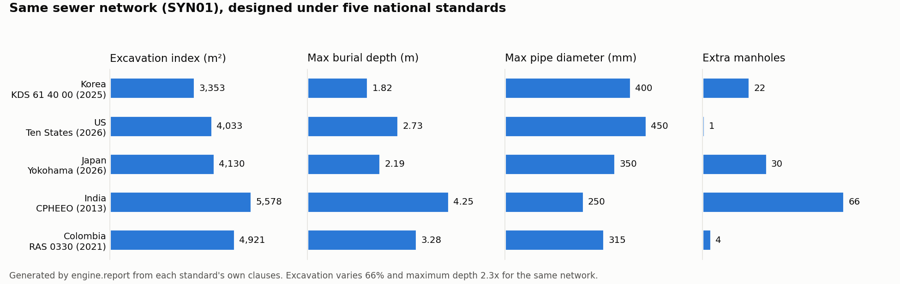

# sewage_design

[English](README.md) | 한국어

각국 하수도(오수관) 설계기준을 원문 그대로 DB화하고, 같은 조건에서 비교하는 설계 엔진.



나라 추가 방법: [CONTRIBUTING.md](CONTRIBUTING.md) (영문)

- 기준: 한국 KDS 61 40 00·61 10 00(2025-10-01), 미국 Ten States Standards 2026, 일본 요코하마시 하수도설계지침(2026)·하수도법 시행령, 인도 CPHEEO Manual on Sewerage 2013, 콜롬비아 RAS(Res. 0330/2017 통합본)
- 원칙: 원문 텍스트 그대로 코드화. 원문이 정하지 않은 부분은 같은 기준의 다른 조항으로만 해소하고, 실무 관행은 넣지 않는다.
- 공개 범위: 재배포가 허용된 원문(CPHEEO, 일본 하수도법 시행령, 콜롬비아 RAS)만 본문·원문 구절·이미지 판독본을 포함한다. 나머지(KDS, Ten States 2026, 요코하마 지침)는 값·조항 번호만 두고 원문 본문과 구절(`quote_short`)은 별도 비공개 폴더(`../sewage_design_private`, `SEWAGE_PRIVATE_DIR`)에 둔다.

## 구조
- `criteria/*.csv` — 수집한 기준값 (조항 번호·구속력, 원문 구절은 재배포 가능한 기준만. 나머지는 비공개 폴더 `criteria_quotes/quotes.csv`에서 적재 시 채움)
- `criteria/normalized/*.jsonl` — 조건 정규화·basis 태깅 (`db/vocabulary.md`)
- `criteria/clauses/`, `criteria/assets/` — 재배포 가능한 조문 원문·이미지 판독본
- `db/` — 스키마(`schema.sql`, `schema_private.sql`)와 적재(`load_criteria.py`)
- `criteria/rules/<standard_id>.json` — 기준별 규칙(규칙 유형 11종), `criteria/projects/<id>.json` — 사업 채택값
- `engine/` — 수리 계산(`hydraulics.py`), 일반 엔진(`generic.py`, `design.py`, 나라 분기 없음), 공통 지표(`metrics.py`), 관망(`network.py`)
- `tests/` — 원문 표를 정답지로 쓰는 회귀 테스트

## 실행
```bash
py -3 db/load_criteria.py <공개 DB DSN> <비공개 DB DSN>
SEWAGE_DB_DSN=<공개 DB DSN> py -3 -m pytest tests
SEWAGE_DB_DSN=<공개 DB DSN> py -3 -m engine.design SYN01
SEWAGE_DB_DSN=<공개 DB DSN> py -3 -m engine.metrics SYN01 --dia 200 250 --q 0.002 --q-initial 0.0008
```

## 출처 표기
- CPHEEO, Manual on Sewerage and Sewage Treatment Systems, Part A: Engineering (2013), Ministry of Housing and Urban Affairs, Government of India.
- Great Lakes – Upper Mississippi River Board, Recommended Standards for Wastewater Facilities, 2026 Edition.
- Ministerio de Vivienda, Ciudad y Territorio (Colombia), Resolución 0330 de 2017 (RAS), texto compilado.

## 라이선스
AGPL-3.0-or-later ([LICENSE](LICENSE)). 기준서 원문의 저작권은 각 발행 기관에 있다.
